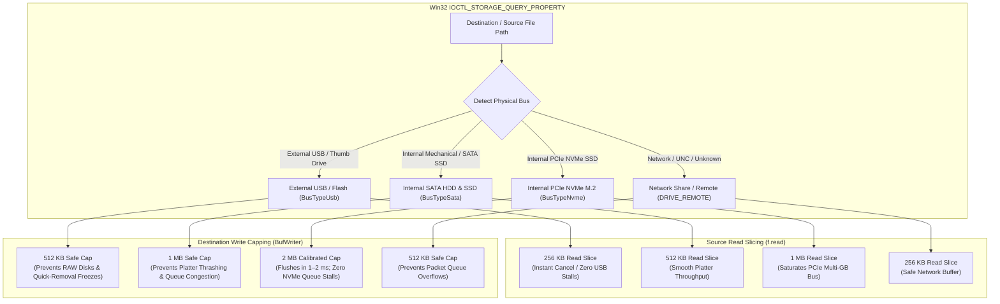

# 📦 Bayzip (v2.1.1)

**Bayzip** is a modern, high-performance file archiver for Windows built with **Tauri 2**, **Rust**, and **React**. Engineered for maximum hardware utilization, it combines multi-threaded compression algorithms (Zstandard, Brotli, LZ4, LZMA2), a hierarchical directory tree explorer, zero-disk safe file previewing, zero-allocation streaming encryption, destination-aware storage buffer capping, smart pre-compressed media bypass, and seamless Windows File Explorer shell integration.


---

## ⚡ Key Features

### 🚀 Smart Pre-Compressed Media Bypass (High-Throughput Store Mode)
- **Zero-CPU Dynamic Store Mode (`zip::CompressionMethod::Stored`) [ZIP & TAR]**:
  - Automatically identifies pre-compressed video, audio, image, and archive formats (`.mp4`, `.mkv`, `.avi`, `.mov`, `.wmv`, `.mp3`, `.flac`, `.ogg`, `.opus`, `.aac`, `.jpg`, `.jpeg`, `.png`, `.webp`, `.avif`, `.gif`, `.zip`, `.7z`, `.rar`, `.gz`, `.bz2`, `.xz`, `.zst`, `.docx`, `.xlsx`, `.pptx`, `.apk`, `.vpk`, `.pak`, `.iso`).
  - When creating `.zip` archives, directly streams already-compressed files to disk uncompressed in Store mode, completely bypassing CPU compression loops.
  - Saturates PCIe Gen4/Gen5 NVMe read/write speeds (1,000–3,000+ MB/s), archiving media directories and downloads in seconds instead of minutes.
  - Highly compressible assets (`.txt`, `.json`, `.xml`, `.exe`, `.dll`, code, game maps) remain fully compressed with multi-threaded Deflate for maximum space reduction.
- **Solid Archiving Dictionary Protection (`.bay`, `.bayg`, `.7z`)**:
  - In continuous solid archives (`.bay`, `.bayg`, `.7z`), all files are part of a continuous compression block; Smart Bypass automatically groups compressible files together first and places pre-compressed media and ISOs at the end.
  - Prevents random, high-entropy media bitstreams from evicting useful LZ77/Zstd dictionary history, improving both compression speed and compression ratio by 5%–15%. (Per-file raw Store blocks for `.bay` are planned for Container v4).
- **Interactive UI Toggle & Windows Explorer Shell Integration**:
  - Added a toggle switch in the Compression Options view (`Smart media bypass (ZIP) [Fast Store]`), active by default.
  - Right-click quick zip via Windows 11 context menu automatically leverages Store mode for instant media archiving.
  - Dedicated preferences status card in Settings.

### 🗂️ Tree-Type Archive Directory Inspector
- **Hierarchical Tree View**:
  - Replaces flat file entry dumps with an expandable/collapsible folder tree (File Explorer and WinRAR style).
  - Folder nodes with open/close chevron state (`▶` / `▼`), subfolder counts, and item count indicators.
  - Interactive breadcrumb trail (`[ 📦 Archive ] / [ 📁 folder ] / [ 📁 subfolder ]`) with direct segment jumping and up-one-level (`⬆`) navigation.
- **Dual-View & Full-Screen Workspace Mode (`⤢`)**:
  - Instant toggle between **`[ 🗂️ Tree View ]`** and **`[ 📋 Flat Table ]`**.
  - **Expand Button (`⤢`)**: Expands the inspector into a full dual-pane workspace modal (left folder hierarchy, right files list) for large archives with status bar stats (total items, uncompressed size, and current folder path).
  - Integrated search and filter bar across all folder levels.
- **Instant TOC Trailer (`O(1)` Archive Inspection)**:
  - `.bay` archives feature a binary Table of Contents trailer (`BAYTOC\x02\x00` + 8-byte LE offset) written at the EOF.
  - Inspect multi-gigabyte archives instantly without full-container decompression or linear reading.

### ✕ Selective Extraction & Exclusion Mode (Skip Mode)
- **HCI-Compliant Inverted File Selection**:
  - By default, all archive files are marked **Included** for 1-click full extraction.
  - Clicking **"Exclude Files"** (`[ ✕ Exclude Files ]`) unlocks interactive exclusion toggles in both Tree and Flat views.
  - Marked unwanted files/folders display a red cross badge `[✕ Excluded]`, dimmed (50% opacity), strikethrough filename, and size indicates `(Skipped)` in soft rose.
  - Skips extracting unwanted files to disk, saving massive disk space and I/O time when only specific files are needed.
- **Decompression Container Stream Alignment**:
  - For streaming `.bay` archives, excluded files are safely drained through an in-memory buffer without creating disk files, preserving container decompressor alignment and data integrity.
  - Supported across `.bay`, `.zip`, `.tar`, and `.7z`.
- **Dynamic Extraction Status**:
  - Dynamic button updates in real time: `[ Extract All (100 Files) ]` vs `[ Extract 98 Files (2 Excluded) ]`.
  - 1-click **"Include All"** reset button in the inspector toolbar and extraction action bar.

### 🛡️ Restricted Safe Preview Mode (In-Memory Streaming)
- **Zero-Disk Streaming**:
  - Preview archive files directly from memory without extracting them to disk across `.bay`, `.zip`, `.7z`, `.tar`, `.tar.gz`, and `.rar`.
  - Trigger preview via **double-click**, **Spacebar**, or the **`👁️ Preview`** button.
- **Safe Code & Text Viewer**:
  - Line numbers, syntax-ready dark theme, word wrap toggle, and 1-click clipboard copy.
  - Supports Markdown, JSON, YAML, TOML, XML, Rust, TypeScript, JavaScript, Python, C/C++, HTML/CSS, SQL, logs, and any UTF-8 document.
- **Image Preview**:
  - Clean in-memory preview for `.png`, `.jpg`, `.jpeg`, `.webp`, `.svg`, `.gif`, `.bmp`, and `.ico` with dimensions and metadata.
- **Restricted Execution Protection**:
  - Strict security guard preventing accidental execution of `.exe`, `.dll`, `.sys`, `.msi`, `.com`, or `.scr` binaries inside the viewer.
  - Shell scripts (`.bat`, `.cmd`, `.ps1`, `.vbs`) are strictly sandboxed into view-only mode with zero execution permissions.

### 🚀 High-Performance Compression & Extraction Engine
- **Hardware-Aware Performance Allocation**:
  - Live hardware specs detection (CPU cores and free RAM).
  - Slider controls compression intensity and core allocation (`0%` -> 1 core, `50%` -> half cores, `100%` -> full multi-threading).
  - **Source & Destination Hardware-Aware I/O Architecture**:
    - **Physical Read Slicing**: Queries underlying drive bus via Win32 `IOCTL_STORAGE_QUERY_PROPERTY` to slice reads safely (256 KB for USB, 512 KB for SATA, 1 MB for NVMe).
    - **Destination-Aware Write Capping**: Automatically caps output write buffers (512 KB for USB thumb drives under Windows Quick-Removal policy, 1 MB for SATA HDD/SSD, up to 2 MB for PCIe NVMe line rate), eliminating 10-to-20-second thread hangs on external flash and NVMe queue stalls while keeping progress bars at 20 FPS with instant cancellation.
  - OS priority scheduling (`ScopedPriorityGuard`) sets background compression threads to below-normal priority to maintain 100% system and game responsiveness.
- **Format Support**:
  - **`.bay`**: High-performance custom format supporting **Zstandard** (Levels 1–19), **Brotli**, and **LZ4**.
  - **`.bayg`**: Ultra-fast gaming modpack preset using Zstd-Fast (capped at Level 3 for near-zero decompression latency).
  - **`.7z`**: 7-Zip LZMA2 multi-threaded compression with smooth progress reporting.
  - **`.zip`**: Standard ZIP with Deflate, uncompressed Store, and BZip2 options.
  - **`.tar`**: Uncompressed TAR container packaging.
  - **Extraction**: Universal extraction for `.bay`, `.bayg`, `.zip`, `.7z`, `.tar`, `.gz`, `.tgz`, and `.rar`.
- **Atomic Operations & Instant Cancellation**:
  - **Atomic `.baypart` Extraction**: Unpacked files are staged into `.baypart` temporary files and atomically renamed upon success. Any extraction cancellation or error immediately scrubs partial files, guaranteeing zero corrupted or half-written files on disk.
  - **Atomic `.baytmp` Compression**: Compression writes to temporary files before atomic finalization.
  - 1-click instant cancellation with real-time UI response and automated temporary file cleanup.
- **Smart Folder Conflict Resolution**:
  - Automatic single-root detection prevents redundant nested directories (e.g., `ArchiveName/ArchiveName/...`) when unpacking archives that already contain a top-level folder.
  - Clean conflict handling avoids spurious auto-numbering `(1)` folders when extracting into fresh or matching target paths.

### 🛡️ Hardware-Aware Drive Protection & Safe Buffer Capping

On Windows, uncapped write buffers (e.g., 64 MB – 128 MB dumps) on external flash drives or mechanical hard drives can lock operating system storage threads, freeze progress bars, and risk partition table/journal corruption (causing drives to appear as **RAW** file systems if interrupted). On fast NVMe drives, massive single-shot writes overwhelm dynamic SLC caches and drive controllers, freezing background workers for seconds.

Bayzip actively queries the underlying drive bus via Win32 `IOCTL_STORAGE_QUERY_PROPERTY` and clamps sequential read slices and write buffers to safe, hardware-calibrated boundaries:



| Storage Medium | Bus Type | Read Slice | Write Buffer Cap | Flush Latency | Core Hardware Safeguard |
|---|:---:|:---:|:---:|:---:|---|
| **External USB / Flash Drive** | `BusTypeUsb` | **256 KB** | **512 KB** | ~0.04 – 0.08s | Prevents Windows Quick-Removal lockups, 20s stalls, and RAW partition corruption |
| **Internal Mechanical HDD / SATA SSD** | `BusTypeSata` | **512 KB** | **1 MB** | ~0.01 – 0.02s | Prevents mechanical platter head thrashing and disk queue congestion |
| **Internal PCIe NVMe SSD (M.2)** | `BusTypeNvme` | **1 MB** | **2 MB** | ~0.001 – 0.002s | Maximum PCIe line rate; flushes in 1–2ms without controller queue saturation |
| **Network Share / UNC / Fallback** | `DRIVE_REMOTE` | **256 KB** | **512 KB** | Safe generic | Prevents packet queue overflows and network driver latency |


### 🔒 Zero-Allocation Streaming AES-256-GCM Encryption
- **In-Place AEAD Streaming**:
  - `ChunkedAesWriter` and `ChunkedAesReader` operate with zero heap allocations per chunk using `AeadInPlace` (`encrypt_in_place` / `decrypt_in_place`).
  - 4 MB chunk size minimizes AEAD authentication tag overhead while maximizing hardware throughput on AES-NI capable CPUs.
  - Constant memory footprint (< 100 MB RAM) regardless of archive size, eliminating Out-Of-Memory (OOM) risks on multi-gigabyte encrypted archives.
  - Clean framing separation between encrypted container payloads and TOC metadata.
- Seamless password prompt with in-place archive unlocking for inspection and previewing.

### 🪟 Windows File Explorer Integration
- **Native Windows 11 Top-Level Context Menu (`IExplorerCommand`)**:
  - Implements Microsoft's modern Windows 11 shell extension standard via in-process COM companion DLL (`bayzip_shell.dll`).
  - Appears directly at the top level of the Windows 11 right-click menu without needing "Show more options" (`Shift+F10`).
  - Features cascading sub-commands with native Fluent icons:
    - *"Compress to .bayg (Gamer Preset)"*
    - *"Compress to .bay (Ultra-Fast)"*
    - *"Extract Here"*
    - *"Open in Bayzip"*
  - Multi-selection support: processes all selected files and folders in batch.
- **Sparse Package Identity (`AppxManifest.xml`)**:
  - Automatically deploys and registers a Windows Sparse Package on Windows 11 (`Build >= 22000`) for seamless modern shell integration.
- **Classic Windows 10 & Legacy Fallback**:
  - Dual-mode support maintains standard `HKCU\Software\Classes` shell registry keys for Windows 10 and classic Explorer contexts.
- **Branded File Associations**:
  - Displays official Bayzip glowing cube icons on `.bay` and `.bayg` files across File Explorer.

---

## 📂 Supported Formats

| Format | Extensions | Creation / Compression | Extraction | In-Memory Preview | Compression Algorithms |
|---|---|:---:|:---:|:---:|---|
| **Bayzip** | `.bay` | ✅ | ✅ | ✅ | Zstandard (Levels 1–19), Brotli, LZ4 |
| **Bayzip Gamer** | `.bayg` | ✅ | ✅ | ✅ | Zstd-Fast (Capped at Level 3) |
| **ZIP** | `.zip` | ✅ | ✅ | ✅ | Deflate, Store, BZip2 |
| **7-Zip** | `.7z` | ✅ | ✅ | ✅ | LZMA2 Multi-Threaded |
| **TAR** | `.tar` | ✅ | ✅ | ✅ | Uncompressed (Store) |
| **GZip / TarGz** | `.gz`, `.tgz` | — | ✅ | ✅ | Deflate / Tar |
| **BZip2 / TarBz2** | `.bz2`, `.tar.bz2` | — | ✅ | ✅ | BZip2 / Tar |
| **XZ / TarXz** | `.xz`, `.tar.xz` | — | ✅ | ✅ | LZMA2 / Tar |
| **Zstandard Tar** | `.zst`, `.tar.zst` | — | ✅ | ✅ | Zstandard / Tar |
| **ISO Image** | `.iso` | — | ✅ | ✅ | ISO 9660 Disc Image |
| **Cabinet** | `.cab` | — | ✅ | ✅ | Microsoft Cabinet |
| **RAR** | `.rar` | — | ✅ (Standard / Unencrypted) | ✅ | Uncompressed & Standard RAR via libarchive (Encrypted RAR5 deferred to v2.2) |

---

## 📋 Release Notes

### v2.1.1 (Latest)
- **Windows 11 Shell Multi-Selection Archiving**: Right-clicking multiple selected files or folders in Windows File Explorer now creates a single unified archive (`ParentFolder.bay`, `.bayg`, `.zip`, `.7z`, or `.tar`) rather than spawning separate individual archives.
- **Silent Headless Subprocess Spawning**: Added `CREATE_NO_WINDOW` (`0x08000000`) flag to Windows shell extension context menu actions, completely eliminating command prompt window flickers when compressing or extracting via right-click.
- **Real-Time Live Speed & ETA Display**: Compression and extraction views now calculate and display real-time throughput transfer speed (e.g., `85.4 MB/s`) and dynamic completion time remaining (`ETA: 12s`).
- **Interactive Drag & Drop Glow Feedback**: Added a Fluent dark overlay with illuminated cyan border glow and drop badge when dragging files or folders into the main window.
- **Calibrated Non-Blocking I/O Streaming**: Calibrated physical read slices (256 KB–1 MB) and destination write caps (512 KB–2 MB) across NVMe, SATA, and USB, eliminating 10–20 second UI stalls and dynamic SLC queue starvation while keeping progress bars at a smooth 20 FPS.
- **Enhanced Windows Shell Integration & Clean Uninstall**: Optimized Windows shell association notifications, removed legacy icon cache calls, added clean `Software\RegisteredApplications` deregistration, and added official Bayzip branding icon to the Windows Add/Remove Programs (Programs & Features) uninstaller entry.
- **Subfolder Path Normalization**: Unified all folder display paths across Windows and cross-platform views using standard forward-slash (`/`) hierarchy formatting.

### v2.0.7
- **Quick Format Selector Dropdown**: Interactive format selector on the Archive Name card enabling 1-click format switching between `.bay`, `.bayg`, `.zip`, `.7z`, and `.tar` without opening Advanced Options.
- **Authentic v2.0.0 UI Aesthetic**: Always-visible Archive Name card with glowing 3D Bayzip icon tile, clean Hardware Allocation layout (`[ ZSTANDARD MULTI-CORE ]` badge, cyan profile name, clean numeric `0`–`100` slider ticks, and `Target RAM Usage` subcard).
- **Responsive Full-Screen Scaling**: Dynamically expands central layout from `max-w-2xl` (~672px) up to `max-w-5xl` (~1024px) when maximized, eliminating empty black voids on widescreen monitors while preserving a compact footprint on standard windows.
- **Settings-Inspired In-App About Modal**: Redesigned About modal with Settings dark glassmorphism aesthetic, active engine architecture panel, 2x2 feature grid, and author creator card.
- **Symmetric Pro Workspace Mode**: Full-screen dual-pane workspace modal with right-hand Action Sidebar across both Compress and Extract workflows, allowing complete archive inspection, breadcrumb navigation, search filtering, and configuration without leaving the view.
- **Fluent Yellow Folder Icons (`#F9D648`)**: Restored authentic Windows 11 Fluent Yellow folder icons across all tree nodes, active directory cards, and flat table views.
- **Resilient Brand Assets**: Standalone `BayzipLogo` vector fallback component ensures brand tiles and logos never break or disappear on asset load failures.

> 📖 **Full Changelog**: For comprehensive release notes, milestone summaries, and full version history across all releases (v1.0.1 through v2.1.1), see [CHANGELOG.md](CHANGELOG.md).

---

## 🚀 Building & Running

### Requirements

- [Node.js](https://nodejs.org/) (v18+)
- [Rust](https://www.rust-lang.org/) (1.75+)
- Windows 10 or 11

### Run in Development

```bash
npm install
npm run tauri dev
```

### Build Production Executable (.exe / Installer)

```bash
npm run tauri build
```

The compiled installer and standalone executable will be generated in `src-tauri/target/release/bundle/nsis/`.

---

## 📜 License

Private © Bayzip.
