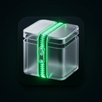
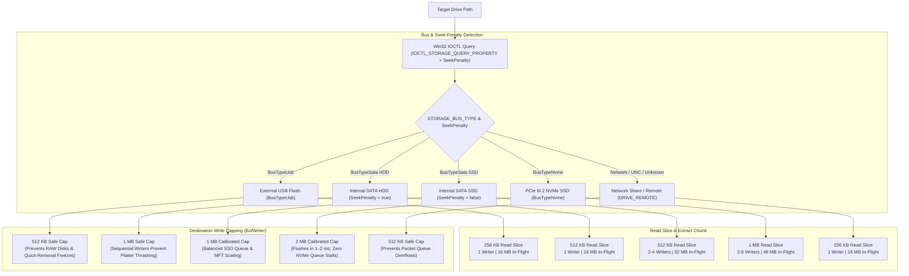

<p align="center">
  
</p>

<h1 align="center">Bayzip</h1>

<p align="center">
  Fast, hardware-accelerated archiver for Windows built with Tauri 2, Rust, and React.
</p>

<p align="center">
  <a href="https://github.com/Baymax005/Bayzip/releases"></a>
  <a href="#windows-shell-integration"></a>
  <a href="https://v2.tauri.app/"></a>
  <a href="src-tauri/Cargo.toml"></a>
  <a href="package.json"></a>
  <a href="package.json"></a>
  <a href="LICENSE"></a>
</p>

<p align="center">
  <a href="src-tauri/src/crypto.rs"></a>
  <a href="TESTS.md"></a>
  <a href="src-tauri/src/compressor/mod.rs"></a>
  <a href="src-tauri/crates/bayzip_shell/src/lib.rs"></a>
  <a href="CHANGELOG.md"></a>
</p>

<p align="center">
  <a href="#-whats-new-in-v300"><b>🚀 What's New in v3.0.0</b></a> •
  <a href="#-key-features"><b>⚡ Key Features</b></a> •
  <a href="#-storage-calibrated-streaming-io"><b>💾 I/O Calibration</b></a> •
  <a href="#-zero-allocation-streaming-aes-256-gcm-encryption"><b>🔒 Security & Cryptography</b></a> •
  <a href="#-windows-file-explorer-integration"><b>🪟 Shell Extension</b></a> •
  <a href="#-supported-formats"><b>📂 Supported Formats</b></a> •
  <a href="TESTS.md"><b>🧪 Test Report</b></a> •
  <a href="#-building--running"><b>🚀 Quick Start</b></a> •
  <a href="CHANGELOG.md"><b>📋 Changelog</b></a>
</p>

---

## 🚀 What's New in v3.0.0

Bayzip **v3.0.0** introduces a ground-up **Multi-Core, Storage-Aware Extraction Architecture** across six engineering phases alongside an upgraded **RFC 8878 Seekable `.bay` / `.bayg` Container Format**:

- **Multi-Frame Seekable `.bay` / `.bayg` Container & Parallel Zstd Unpacking (`compressor/bay.rs`, `inspector/bay.rs`, `extractor/bay.rs`)**:
  - Unencrypted Zstandard archives now emit independent seekable Zstd frames (`8 MB` frames for `.bayg` Gamer Preset; `16 MB` frames for `.bay`) indexed by an RFC 8878 Seek Table skippable frame (`0x184D2A5E` / `0x8F92EAB1`) directly ahead of the instant `BAYTOC\x02\x00` trailer.
  - `ParallelSeekableZstdReader` decodes frames concurrently across `2–8` `zstd::bulk::Decompressor` workers inside a bounded `96 MB` sliding window with recycled buffers, using independent `open_random_read` handles on SSDs/NVMe and serialized sequential reads on spinning HDDs/USB drives—while remaining 100% backward-compatible with legacy single-frame `.bay` and encrypted `BAYENC\x03` archives.
- **Storage-Aware Win32 NTFS I/O & `AsyncFileWriterPool` (`inspector/hardware.rs`, `extractor/io.rs`, `extractor/mod.rs`)**:
  - Queries both `STORAGE_BUS_TYPE` and `StorageDeviceSeekPenaltyProperty` (`PropertyId = 7`) via `IOCTL_STORAGE_QUERY_PROPERTY` to distinguish NVMe SSDs, SATA SSDs, spinning HDDs, and USB flash drives.
  - Applies Win32 `FILE_FLAG_SEQUENTIAL_SCAN` / `FILE_FLAG_RANDOM_ACCESS` hints, NTFS `FileAllocationInfo` preallocation for files `>= 64 KB`, `DirectoryCache` ancestor tracking to eliminate redundant `create_dir_all` syscalls, and a byte-budgeted `AsyncFileWriterPool` (`16–48 MB` in-flight cap) with per-worker `ScopedPriorityGuard` and deterministic `abort_and_join()` rollback cleanup.
- **Parallel Multi-Core `.zip` Extraction & SIMD `zlib-rs` (`Cargo.toml`, `extractor/zip.rs`)**:
  - Switched `flate2` to `zlib-rs` SIMD hardware acceleration and enabled `zip` `deflate-flate2`.
  - Added zero-seek Pass 1 central-directory planning (`name_for_index`), case-insensitive duplicate conflict resolution (last-wins), per-worker `open_random_read` handles (`2–8` NVMe / `2–6` SATA SSD / sequential HDD & USB), and Zip-Bomb `eof_check` guards.
- **Zero-Double-Buffer Pipelined `.bay` Extraction & Async AES Read-Ahead (`extractor/bay.rs`, `priority.rs`, `tester.rs`)**:
  - Eliminated double buffering via `zstd::stream::Decoder::with_buffer` and added `PipedAesBufReader` (`8 × 512 KB` zeroized ring buffers) to overlap AES-256-GCM decryption on a read-ahead thread with Zstd decompression and async file writes, plus bounded `locate_bay_payload_end` framing for `BAYTOC` trailers.
- **Multi-Block Parallel `.7z` & Native SIMD `.tar` / `.tar.gz` / `.tar.zst` (`extractor/sevenz.rs`, `extractor/tar.rs`, `extractor/mod.rs`)**:
  - Added Longest-Processing-Time parallel `.7z` block workers (`open_random_read`) governed by storage seek-penalty limits and a `512 MB` (`SEVENZ_MAX_CONCURRENT_DICT_BYTES`) dictionary RAM ceiling, `Lzma2ReaderMt` + `AsyncFileWriterPool` for solid blocks, cross-block duplicate serialization, and stream-aligned `drain_7z_entry` skipping.
  - Routed `.tar`, multi-member `pigz`/`.tar.gz` (`MultiGzDecoder` via `zlib-rs` SIMD), and multi-frame `.tar.zst` through a native streaming Rust extractor with `DirectoryCache`, `AsyncFileWriterPool`, and single-pass `hoist_single_root_dir`.
- **Single-Pass Cancellable System `tar.exe` Inspection (`extractor/system_tar.rs`)**:
  - Replaced three sequential `tar.exe` pre-scans with a single cancellable streaming `tar.exe -tvf` pass and fail-closed `parse_bsdtar_tvf_line` parser (rejecting symlinks, hardlinks, FIFOs, sockets, and device nodes mid-stream) plus fast `DirectoryCache` staged finalization.
- **Expanded Verification**:
  - Automated Rust test suite expanded from **57 to 90 unit tests (`90/90 passing`)**, verified alongside `0` Clippy warnings and `0` TypeScript errors.

---

## ⚡ Highlights

| Feature | Description | Architecture Component |
|---|---|---|
| **⚡ Multi-Core Seekable Extraction Engine (v3.0.0)** | Parallel Zstd `.bay`/`.bayg` frames, multi-core SIMD `zlib-rs` `.zip`, multi-block `.7z` + LZMA2-MT, native `.tar`/`.tar.gz`/`.tar.zst`, and async Win32 NTFS writer pools. | `extractor/`, `compressor/bay.rs` |
| **🛡️ In-Place Archive Integrity & CRC-32 Tester** | High-throughput zero-disk-write stream verification engine validating container parity, CRC-32 checksums, and encrypted blocks with live UI telemetry. | `tester.rs` |
| **🏎️ Ultra-Fast Gamer Preset (`.bayg`)** | Locked at Zstandard Level 3 with `8 MB` seekable frames for maximum multi-core game installation, repack, and transfer throughput. | `compressor/bay.rs`, `extractor/bay.rs` |
| **🛡️ Zip-Slip & Path Traversal Proof** | Multi-layer sanitization rejecting directory escapes (`..`), DOS device aliases (`CLOCK$`, `CONFIG$`, `CON`), NTFS ADS colons, illegal characters, and external link/device entries. | `inspector/mod.rs`, `extractor/system_tar.rs` |
| **⚡ 100k-File Virtualized UI** | Silky 60 FPS scrolling and $O(1)$ folder lookups using custom debounced virtual scrolling and memoized tree hierarchies. | `VirtualScrollList.tsx` |
| **🔒 Streaming Chunked AEAD Encryption** | 4 MB chunked AES-256-GCM streaming with async read-ahead ring pipeline (`PipedAesBufReader`), constant < 100 MB RAM footprint, and cryptographic EOF truncation detection. | `crypto.rs`, `extractor/bay.rs` |
| **🪟 Windows 11 Native Context Menu** | In-process Win32 COM DLL (`IExplorerCommand`) top-level menu integration with MSIX Sparse Package identity and verified binary resolution. | `bayzip_shell.dll` |
| **💾 Storage Bus & Seek-Penalty Calibration** | Win32 IOCTL detection (`STORAGE_BUS_TYPE` + `StorageDeviceSeekPenaltyProperty`) scaling thread counts, NTFS preallocation, and buffers across NVMe, SATA SSD, HDD, and USB. | `inspector/hardware.rs`, `extractor/io.rs` |

---

## ⚡ Key Features

### 🛡️ In-Place Archive Integrity Tester & CRC-32 Verification (v2.4.0)
- **High-Throughput Zero-Disk-Write Verification (`src-tauri/src/tester.rs`)**:
  - Validates container parity and entry checksums by streaming decompressed payloads directly into an in-memory discard sink (`std::io::sink()`) with zero disk writes.
  - Multi-container integrity checking for `.bay`, `.bayg`, `.zip` (rolling CRC-32 vs central directory headers), `.7z` (folder block decoding and CRC validation), `.tar.*` (block header checksums and delegated `.xz`/`.bz2`/`.iso`/`.cab` handling), full `.bay` stream EOF verification, and full payload streaming via `tar.exe -xvf -O` for system `tar.exe` fallback formats.
  - Runs inside `tauri::async_runtime::spawn_blocking` protected by `ScopedPriorityGuard` (`THREAD_PRIORITY_BELOW_NORMAL`) ensuring smooth system and gaming performance.
  - Real-time cancellation (`cancel_test_archive` / `CANCEL_TEST`) and ~40ms throttled progress event emitter (`test_progress`).
- **In-Place UI Telemetry & Verification Indicators (`ArchiveTreeInspector.tsx`)**:
  - `2px` Sky Blue (`#38BDF8`) live stream line along the top edge of the footer status bar with active file, percentage, throughput telemetry, and inline `[ Cancel ]` button.
  - Flashes emerald green `✓ Stream Verified 100% OK (X items, 0 CRC errors)` on completion.
  - Displays persistent `✓ OK` badges on verified archive rows.

### 🖥️ Fluent Zinc & Sky Single-Screen Desktop Utility (v2.4.0)
- **Zero-Scroll Main Window Architecture (`App.tsx`)**:
  - Desktop-native layout locked to `h-screen overflow-hidden flex flex-col bg-[#141416]` — the main chrome never scrolls; only the inner file viewer scrolls.
  - Neutral dark zinc/graphite palette (`#141416` / `#1C1C1F`) with crisp `1px solid #2E2E34` borders and `#38BDF8` sky blue interactive accents.
- **Unified Top Ribbon Toolbar**:
  - Single streamlined action bar with contextual sky-blue primary button states (`[ 📦 Compress... ]` when staging files; `[ 📤 Extract... ]` when opening archives).
- **Keka-Style Compact Popup Dialogs with Live Streaming Morph**:
  - Completely eliminated `backdrop-blur` and heavy window overlays; dialogs stay neatly contained within the File Viewer bounds.
  - Compact `CompressModal` with notched hardware slider (`Store`, `Fast`, `Balanced`, `High`, `Ultra`) and archive format dropdowns.
  - Smoothly morphs upon action into a **Live Streaming Progress View** showing throughput, ETA, streamed bytes, current item, and minimize-to-footer option.

### 🗃️ Unified Desktop Drop Hub & Fast Directory Tree Inspector (v2.3.7)
- **High-Performance Archive Directory Inspector (`ArchiveTreeInspector.tsx`)**:
  - Direct, fast tree & list view of loaded archive contents with instant folder hierarchy navigation.
  - Interactive parent navigation (`..`) and clickable breadcrumb navigation (`📦 root / folder / subfolder`).
  - Real-time search and filter input with instantaneous filename matching.
  - In-memory file content preview modal (`FilePreviewModal.tsx`) for images, text, and code files.
  - Selective extraction: include/exclude specific files and subfolders with 1-click checkboxes.
  - Password-protected archive unlock banner for encrypted archives.
- **Standalone VirtualScrollList (`VirtualScrollList.tsx`)**:
  - Reusable, generic virtual scroll list component handling 100,000+ files at smooth 60 FPS with `requestAnimationFrame` scroll debouncing.
- **Focused Compression & Extraction Workflows**:
  - Clean separation: fast archive creation (drop files, format presets, multi-core slider, encryption) and fast extraction (open, inspect, extract).

### 🚀 Smart Pre-Compressed Media Bypass (High-Throughput Store Mode)
- **Zero-CPU Dynamic Store Mode (`zip::CompressionMethod::Stored`) [ZIP & TAR]**:
  - Automatically identifies pre-compressed video, audio, image, and archive formats (`.mp4`, `.mkv`, `.avi`, `.mov`, `.wmv`, `.mp3`, `.flac`, `.ogg`, `.opus`, `.aac`, `.jpg`, `.jpeg`, `.png`, `.webp`, `.avif`, `.gif`, `.zip`, `.7z`, `.rar`, `.gz`, `.bz2`, `.xz`, `.zst`, `.docx`, `.xlsx`, `.pptx`, `.apk`, `.vpk`, `.pak`, `.iso`).
  - Directly streams already-compressed files uncompressed in Store mode, completely bypassing CPU compression loops.
  - Saturates PCIe Gen4/Gen5 NVMe read/write speeds (1,000–3,000+ MB/s), archiving media directories and downloads in seconds instead of minutes.
  - Highly compressible assets (`.txt`, `.json`, `.xml`, `.exe`, `.dll`, source code) remain fully compressed with multi-threaded Deflate for maximum space reduction.

---

## 💾 Storage-Calibrated Streaming I/O

Bayzip inspects physical drive characteristics via Win32 IOCTL (`IOCTL_STORAGE_QUERY_PROPERTY`) for both `STORAGE_BUS_TYPE` and `StorageDeviceSeekPenaltyProperty` (`PropertyId = 7`) to calibrate read slices, write buffers, NTFS `FileAllocationInfo` preallocation (`>= 64 KB`), and parallel extraction concurrency to the exact drive profile:



| Storage Medium | Bus / Seek Profile | Read Slice | Write Buffer Cap | Extract Writers / In-Flight Budget | Core Hardware Safeguard |
|---|:---:|:---:|:---:|:---:|---|
| **Internal PCIe NVMe SSD (M.2)** | `BusTypeNvme` / No Seek | **1 MB** | **2 MB** | **2–6** writers (`2–8` ZIP/7z/.bay workers) / **48 MB** | Maximum PCIe line rate without NTFS `$MFT` lock convoys |
| **Internal SATA SSD** | `BusTypeSata` / No Seek | **512 KB** | **1 MB** | **2–4** writers (`2–6` ZIP/7z/.bay workers) / **32 MB** | Multi-queue SSD extraction without saturating AHCI/SATA channels |
| **Internal Mechanical SATA HDD** | `BusTypeSata` / Seek Penalty | **512 KB** | **1 MB** | **1** writer (Sequential ZIP/7z) / **16 MB** | Keeps disk I/O sequential to prevent mechanical platter head thrashing |
| **External USB / Flash Drive** | `BusTypeUsb` | **256 KB** | **512 KB** | **1** writer (Sequential ZIP/7z) / **16 MB** | Prevents Windows Quick-Removal lockups, stalls, and RAW corruption |
| **Network Share / UNC / Fallback** | `DRIVE_REMOTE` | **256 KB** | **512 KB** | **1** writer / **16 MB** | Prevents packet queue overflows and remote handle stalls |

---

## 🔒 Zero-Allocation Streaming AES-256-GCM Encryption

- **In-Place AEAD Streaming**:
  - `ChunkedAesWriter` and `ChunkedAesReader` operate with zero heap allocations per chunk using `AeadInPlace` (`encrypt_in_place` / `decrypt_in_place`).
  - 4 MB chunk size minimizes AEAD authentication tag overhead while maximizing hardware throughput on AES-NI capable CPUs, with deterministic `Drop` and per-chunk zeroization of plaintext buffers and base nonces plus `BAYTOC` spoof protection on encrypted headers.
  - Constant memory footprint (< 100 MB RAM) regardless of archive size, eliminating Out-Of-Memory (OOM) risks on multi-gigabyte encrypted archives.
  - Explicit 4-byte EOF end-of-stream delimiter verifies payload integrity and rejects truncated streams with `UnexpectedEof`.
- **Key Derivation**: Argon2id / PBKDF2 salt-derived symmetric keys with random 8-byte nonces.

---

## 🪟 Windows File Explorer Integration
<a id="windows-shell-integration"></a>

- **Native Windows 11 Top-Level Context Menu (`IExplorerCommand`)**:
  - Implements Microsoft's modern Windows 11 shell extension standard via companion in-process COM DLL (`bayzip_shell.dll`).
  - Appears directly at the top level of the Windows 11 right-click menu without needing "Show more options" (`Shift+F10`).
  - Cascading sub-commands with native Fluent icons:
    - *"Compress to .bayg (Gamer Preset)"*
    - *"Compress to .bay (Ultra-Fast)"*
    - *"Extract Here"*
    - *"Extract to Subfolder"*
    - *"Open in Bayzip"*
  - Context-sensitive visibility (`ECS_HIDDEN`): extraction verbs hide automatically on folders and non-archive files.
  - Multi-selection & batch support: processes multiple selected files/folders and queues sequential multi-archive mini-extractions cleanly.
  - Cached startup registration (`registration_stamp.txt`) skips redundant registry writes on launch and bypasses background sync in mini-extract invocations.
- **Sparse Package Identity (`AppxManifest.xml`)**:
  - Deploys a Windows Sparse Package on Windows 11 (`Build >= 22000`) for seamless modern shell integration.
- **Classic Windows 10 Fallback**:
  - Dual-mode support maintains standard `HKCU\Software\Classes` shell registry keys for Windows 10 and classic Explorer contexts.

---

## 📂 Supported Formats

| Format | Extension | Create | Extract | Preview | Algorithms & Engines |
|---|---|:---:|:---:|:---:|---|
| **Bayzip** | `.bay` | ✅ | ✅ | ✅ | Seekable Multi-Frame Zstandard (`16 MB` frames, Levels 1–19, parallel unpack), Brotli, LZ4, AES-256-GCM (`PipedAesBufReader`) |
| **Bayzip Gamer** | `.bayg` | ✅ | ✅ | ✅ | Seekable Multi-Frame Zstd-Fast (`8 MB` frames, Level 3 cap, `2–8` core parallel unpack) |
| **ZIP** | `.zip` | ✅ | ✅ | ✅ | Parallel Multi-Core (`2–8` NVMe / `2–6` SSD workers), `zlib-rs` SIMD Deflate, Store (Smart Media Bypass), BZip2 |
| **7-Zip** | `.7z` | ✅ | ✅ | ✅ | Multi-Block Parallel Workers + `Lzma2ReaderMt`, `512 MB` Dict RAM Cap, AES-256 |
| **TAR** | `.tar` | ✅ | ✅ | ✅ | Native Streaming Rust Engine + `AsyncFileWriterPool` + `DirectoryCache` |
| **GZip / TarGz** | `.gz`, `.tgz`, `.tar.gz` | — | ✅ | ✅ | Native `zlib-rs` SIMD `MultiGzDecoder` (Multi-Member `pigz`) + Tar |
| **Zstandard Tar** | `.zst`, `.tar.zst` | — | ✅ | ✅ | Native Multi-Frame Zstandard `Decoder` + Tar |
| **BZip2 / TarBz2** | `.bz2`, `.tar.bz2` | — | ✅ | ✅ | Single-Pass Cancellable `tar.exe` Streaming Engine (BZip2 / Tar) |
| **XZ / TarXz** | `.xz`, `.tar.xz` | — | ✅ | ✅ | Single-Pass Cancellable `tar.exe` Streaming Engine (LZMA2 / Tar) |
| **ISO Image** | `.iso` | — | ✅ | ✅ | Single-Pass Cancellable `tar.exe` Streaming Engine (ISO 9660) |
| **Cabinet** | `.cab` | — | ✅ | ✅ | Single-Pass Cancellable `tar.exe` Streaming Engine (Microsoft Cabinet) |
| **RAR** | `.rar` | — | ✅ | ✅ | Single-Pass Cancellable `tar.exe` / libarchive with Link/Device Guard |

---

## 🚀 Building & Running

### Prerequisites
- [Node.js](https://nodejs.org/) (v18+)
- [Rust](https://www.rust-lang.org/) (2021 Edition / 1.77+) with `x86_64-pc-windows-msvc` target
- Windows 10 or 11 (64-bit)

### Development
```bash
# Clone the repository
git clone https://github.com/Baymax005/Bayzip.git
cd Bayzip

# Install frontend dependencies
npm install

# Run desktop app in development mode
npm run tauri dev
```

### Production Build (.exe / NSIS Installer)
```bash
npm run tauri build
```
The compiled installer will be located in `src-tauri/target/release/bundle/nsis/`.

<a id="automated-tests"></a>
### Run Test Suite
```bash
# Backend unit tests (crypto, path sanitization, priority guards, specs)
cargo test --manifest-path src-tauri/Cargo.toml

# Frontend TypeScript typecheck
npx tsc --noEmit
```

---

## 👤 Author

**Muhammad Ali** ([@Baymax005](https://github.com/Baymax005))

## 📜 License

Distributed under the MIT License. See [LICENSE](LICENSE) for details.
